<h1 data-importer="text" align="left">Hi, I'm Sheeth Al-Kharusi</h1>

###

I'm a Software Developer

###

<h2 data-importer="text" align="left">About me</h2>

###

  

###

I'm a Software development graduate passionate about building: - 🧠 Practical software solutions, - 👩‍💻 Full-stack applications  - 🤖AI-powered systems.

###

<h2 data-importer="text" align="left">I code with</h2>

###

  
  
  
  
  
  
  
  
  
  
  
  
  
  
  
  
  
  
  
  
  
  
  
  
  
  
  
  
  
  
  
  
  
  
  
  
  
  
  
  
  
  
  
  
  
  
  
  
  
  
  
  
  
  
  

###

 

  
  

###

###
